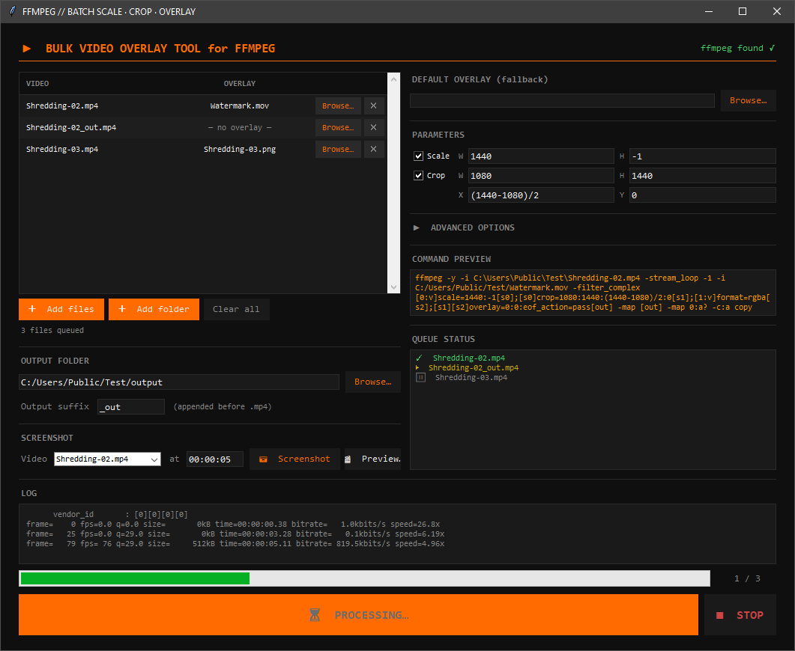
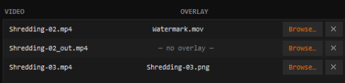
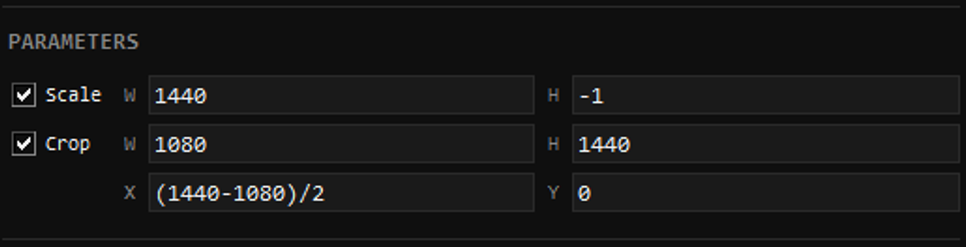
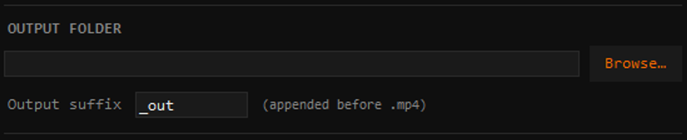
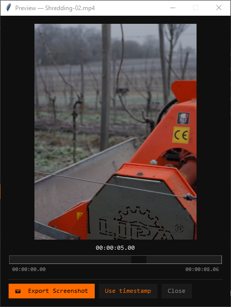

# Bulk Video Overlay Tool for FFMPEG

A dark-themed desktop app for bulk-adding overlays to videos, with extra options for scaling, cropping, encoding, and trimming. No command line needed.

The repo also contains the **[Carousel Builder](#carousel-builder)** — a browser tool that turns an Instagram carousel brief into finished slides.

**Requirements:** Python 3.x · ffmpeg

```
pip install tkinter   # usually bundled with Python
python BulkVideoOverlayTool.py
```

### Finding ffmpeg
ffmpeg does **not** have to be on your PATH. On start the tool looks in this order:

| # | Where | Example |
|---|-------|---------|
| 1 | A path you picked earlier | saved in `~/.bulk_video_overlay_tool.json` |
| 2 | PATH | `ffmpeg` |
| 3 | Next to the script | `./ffmpeg.exe`, `./ffmpeg/bin/ffmpeg.exe`, `./bin/` |
| 4 | Common install folders | WinGet, Scoop, Chocolatey, `C:\ffmpeg\bin`, `Program Files\ffmpeg\bin`, Homebrew |
| 5 | The `imageio-ffmpeg` Python package | `pip install imageio-ffmpeg` |

If none is found the header shows **ffmpeg NOT found ✗ (click to locate)** — click it and pick `ffmpeg.exe`; the choice is remembered.

---

## Overview



---

## Step 1 — Add Videos

### Add individual files
Click **＋ Add files** and pick one or more video files (`.mp4`, `.avi`, `.mkv`, `.webm`).

### Add a whole folder
Click **＋ Add folder** to load every video in a folder at once.  
`.mov` files are skipped automatically (they are treated as overlays).

### Auto-pairing
When adding a folder, any video that has a file with the **same name** is automatically paired as its overlay:

```
/videos
  ├── clip_01.mp4  ←─┐ auto-paired
  ├── clip_01.png  ←─┘
  ├── clip_02.mp4  ←─┐ auto-paired
  └── clip_02.mov  ←─┘
```

---

## Step 2 — Assign Overlays

Each row shows the video, its paired overlay, and a **Browse…** button to swap it.



Set the **Default Overlay (fallback)** in the right column — any video without its own overlay uses it.

Overlays can be **images** (PNG, JPG, WEBP) or **videos** (MP4, MOV, MKV…).  
Image overlays stay on screen for the **whole video**.  
Video overlays loop automatically — only complete cycles play, so the overlay never cuts off mid-loop.

---

## Step 3 — Set Parameters



| Setting | Default | Description |
|---------|---------|-------------|
| **Scale W / H** | `1080` / `1440` | Output frame. With both set, the video is scaled until it **fills** the frame (no black bars). Use `-1` on one axis to keep the aspect ratio instead. |
| **Crop W / H** | `1080` / `1440` | Width and height of the cropped region. |
| **Crop X / Y** | `(iw-ow)/2` / `(ih-oh)/2` | Top-left offset — centred by default. Use `0` for the left / top edge. |

With the default preset **every video comes out at 1080×1440**, whatever its size or orientation:

```
3840×2160 (4K landscape) ─┐
2160×3840 (4K portrait)  ─┤  scale to fill  ──►  crop centre  ──►  1080×1440
1920×1080 · 1440×1440 …  ─┘
```

Uncheck **Scale** or **Crop** to skip that step entirely. With only **Scale** checked, the fill is centred automatically.

---

## Step 4 — Output Folder & Suffix



Each file is saved as `<original_name><suffix>.mp4`.  
Leave the output folder blank to save next to the source files.

---

## Step 5 — Run

Click **▶ RUN BATCH**. Each file's status is tracked live in the Queue Status panel.

Click **■ STOP** to finish the current file then halt.

---

## Screenshot & Preview

### Preview window
Click **🎬 Preview…** to open a live scrubber with all filters applied.



Drag the slider to any frame. **Export Screenshot** saves that frame as a PNG. **Use timestamp** copies the time back to the Screenshot field.

### Quick screenshot
Pick a video in the **Screenshot** row, enter a timestamp, and click **📷 Screenshot** to save a PNG directly.

---

## Advanced Options

Click **▶ ADVANCED OPTIONS** to expand the encoding panel.

```
┌───────────────────────────────────────────────────┐
│  ▼ ADVANCED OPTIONS                               │
├───────────────────────────────────────────────────┤
│  Codec  [ libx264      ▼ ]   CRF     [  23 ]      │
├───────────────────────────────────────────────────┤
│  Audio  [ copy         ▼ ]   Bitrate [ 128k ]     │
├───────────────────────────────────────────────────┤
│  FPS    [        ]   (blank = source fps)         │
├───────────────────────────────────────────────────┤
│  Trim   [ 00:00:05 ]   →   [ 00:01:30 ]           │
└───────────────────────────────────────────────────┘
```

| Option | Description |
|--------|-------------|
| **Codec** | `libx264` (H.264) · `libx265` (H.265/HEVC) · `libvpx-vp9` (VP9) |
| **CRF** | Quality — lower = better quality, larger file. Typical range: 18–28. |
| **Audio** | `copy` pass through · `encode` re-encode to AAC · `strip` remove audio |
| **Bitrate** | AAC bitrate when Audio is set to `encode` (e.g. `128k`, `192k`) |
| **FPS** | Output frame rate. Leave blank to keep the source frame rate. |
| **Trim** | Start and end timestamps (`HH:MM:SS`). Leave blank for the full video. |

---

## Command Preview

Shows the exact ffmpeg command for the first queued video. Updates live as you change any setting.

```
┌────────────────────────────────────────────────────────────┐
│  ffmpeg -y -i clip_01.mp4 -i logo.png                      │
│  -filter_complex                                           │
│    "[0:v]scale=1080:1440:                                  │
│          force_original_aspect_ratio=increase[s0];         │
│     [s0]crop=1080:1440:(iw-ow)/2:(ih-oh)/2[s1];            │
│     [s1]setsar=1[s2]; [1:v]format=rgba[s3];                │
│     [s2][s3]overlay=0:0:eof_action=repeat[s4];             │
│     [s4]format=yuv420p[out]"                               │
│  -map [out] -map 0:a? -c:a copy                            │
│  -c:v libx264 -crf 23 output/clip_01_out.mp4               │
└────────────────────────────────────────────────────────────┘
```

---

## Tips

- **Alpha transparency** is fully supported for PNG overlays.
- **10-bit / HDR phone footage** is converted to standard 8-bit `yuv420p`, so it encodes and plays everywhere.
- Odd sizes from `-1` are rounded to even numbers automatically (H.264 requires it).
- **Video overlay looping** only repeats complete cycles — if the overlay is longer than the source it plays once and stops cleanly.
- **Expressions in crop fields** like `(iw-1080)/2` are passed directly to ffmpeg and evaluated at runtime.
- Batch processing runs in a background thread — the UI stays responsive during encoding.

---

# Carousel Builder

A local browser app for Instagram carousel briefs: paste the brief, get finished **1080×1440** slides — images as PNG/JPG, videos as MP4 with the text burned in, plus a preview PDF.

**Requirements:** Python 3.x · ffmpeg (found the same way as above) · fonts **Neutraface Text Book** and **Trajan Pro 3** installed

```
pip install -r requirements.txt
python carousel/app.py          # opens http://127.0.0.1:5173
```

```
┌──────────────┬──────────────────────────────┬───────────────────┐
│ BRIEF        │                              │ SLIDE 3           │
│              │        ┌──────────────┐      │ Preset            │
│ Slide 1 …    │        │      TEXT    │      │ Text / Lines      │
│ Groß Typo:   │        │              │      │ Position  ↖ ↑ ↗   │
│ LIVE         │        │    1080×1440 │      │           ← • →   │
│ …            │        │    preview   │      │           ↙ ↓ ↘   │
│              │        └──────────────┘      │ Shade             │
│ [Parse]      │  [1] [2] [3] [4] [5]  strip  │ Media · Crop      │
└──────────────┴──────────────────────────────┴───────────────────┘
```

---

## Step 1 — Paste the Brief

Paste the brief and click **Parse**. The parser understands this structure:

```
Slide 1 (Typo wie ON TOUR)          ← slide + title preset
Groß Typo:                          ← big title typography
LIVE                                ← headline lines
TASTING
24 MONTHS EDITION | 24.11.2026      ← sub line (after "|" = own line)
Bild:                               ← image  (Video: for videos)
https://www.picdrop.com/…
oder:                               ← alternative image
https://www.picdrop.com/…

Slide 2:
Video:
https://next.frame.io/share/…
Text:                               ← body text of the slide
Verkostet gemeinsam mit …
```

| Preset | Triggered by | Layout |
|--------|--------------|--------|
| **ON TOUR** | `Typo wie ON TOUR`, `Groß Typo:` | Logo on top, big left-aligned Trajan headline, Neutraface sub line |
| **GET TO KNOW** | `Typo wie GET TO KNOW`, `Klein Typo:` | Small centred Neutraface kicker + Trajan title |
| **Body** | every other slide | Body text only |

**Parse with Claude** does the same via the Claude API for messy briefs (`pip install anthropic`, set `ANTHROPIC_API_KEY`).

---

## Step 2 — Media

| Source | What happens |
|--------|--------------|
| **Picdrop** | Downloaded automatically in full resolution. |
| **Frame.io** | The slide is laid out on the poster image first. Click **Get Frame.io videos** → the links open in your browser → click *Download* there. Every file landing in your **Downloads** folder with the matching Frame.io name is imported into its slide automatically. |
| **Drag & drop** | Drop files anywhere. They are matched by Frame.io name, by `Slide N` in the file name, or to the selected slide when dropped onto the preview. |

Video slides use the **first frame** of the video as the preview background.

---

## Step 3 — Text Placement

Body text is set in **Neutraface 36pt, uppercase, tracking 300** and balanced into **4–6 even lines**, preferring breaks after punctuation. Lists switch to 32pt with spacing between the items.

The text goes into the most readable of 9 zones — calm, dark and away from faces:

```
┌─────────────────┐
│ ↖      ↑      ↗ │   top
│ ←      •      → │   middle
│ ↙      ↓      ↘ │   bottom
└─────────────────┘
  left  centre  right  (= text alignment)
```

A **⚠** in the inspector warns when the background is busy or bright.

---

## Step 4 — Adjust

Everything previews in real time.

| Control | Description |
|---------|-------------|
| **Drag text** | Move any block. Snaps to the margins and the centre — hold **Alt** to move freely. |
| **Position grid** | Jump to one of the 9 zones. **Auto-place** picks the best one again. |
| **Lines on slide** | Edit the wrapped lines directly. **Auto-wrap** re-balances, **lines − / +** changes the line count, **size − / +** the font size. |
| **Drag / scroll photo** | Pan and zoom the background (also via the **Crop** sliders). |

### Shade behind text
A soft cushion behind the text for busy photos.

| Setting | Description |
|---------|-------------|
| **Strength** | Opacity of the shade. |
| **Softness** | How smooth the gradient edge is. |
| **Size** | How far the shade reaches beyond the text. |
| **Mode** | **Multiply** (darkens like the Illustrator blend mode) or **Normal** (plain transparency). |
| **Colour** | Shade colour — black by default. |

---

## Step 5 — Export

Click **Export all**. Files are written to `projects/<name>/export/`:

```
export/
  ├── slide01.png / .jpg     image slides
  ├── slide02.mp4            video slides: cropped to 1080×1440, text burned in, audio kept
  ├── slide02_text.png       transparent text layer (for re-editing in Premiere etc.)
  └── preview.pdf            all slides, for client approval
```

**Open folder** opens the export folder.

---

## Tips

- Typography presets (sizes, positions, tracking) live in `carousel/presets.json` — measured from the Illustrator files.
- Fonts can also be placed in `carousel/assets/fonts/` instead of being installed.
- The ON TOUR logo is read from `carousel/assets/logo.png` (white on transparent). It is not part of the repo — add your own.
- Projects are saved automatically; reopen them from the dropdown in the header.
